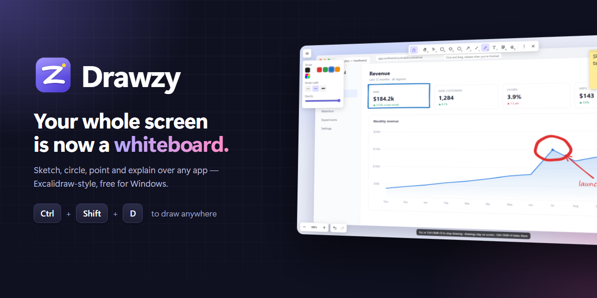
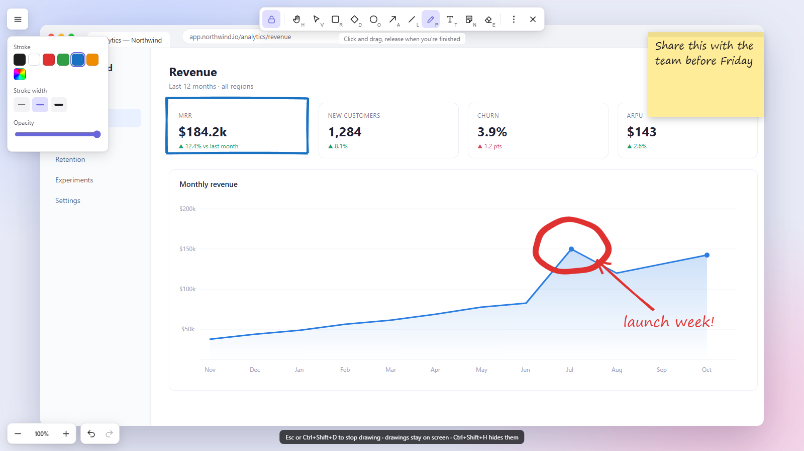
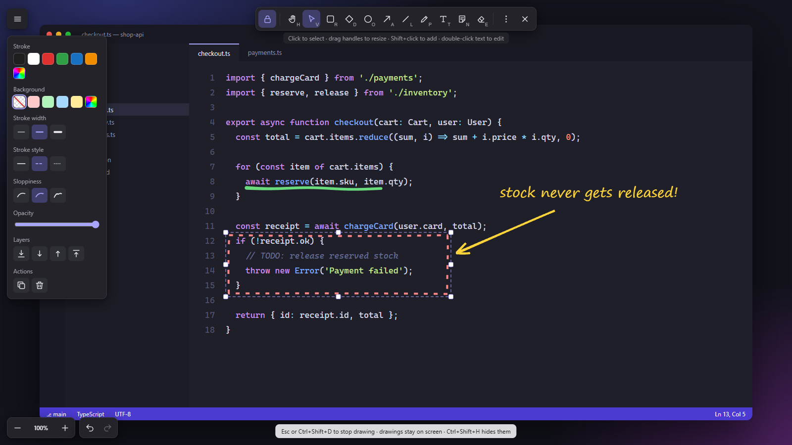

<div align="center">



<br>

**Draw on anything on your screen.** Sketch, circle, point and explain over any app with Excalidraw-style tools — then get back to work with one shortcut.

[](https://github.com/Aayush-shrma/drawzy/releases/latest/download/Drawzy-Setup.exe)
&nbsp;
[](https://github.com/Aayush-shrma/drawzy/releases/latest/download/Drawzy-mac.dmg)

[](https://github.com/Aayush-shrma/drawzy/releases/latest)
[](https://github.com/Aayush-shrma/drawzy/releases)
[](#-install)
[](https://github.com/Aayush-shrma/drawzy/actions/workflows/build.yml)
[](LICENSE)

</div>

---

## ✨ Why Drawzy

Explaining something on screen usually means taking a screenshot, opening an editor, scribbling, and pasting it somewhere. Drawzy skips all of that: press **`Ctrl` + `Shift` + `D`** (**`⌘` + `Shift` + `D`** on a Mac) and draw straight on top of whatever you're looking at — a slide, a dashboard, a bug in your code, a game, a video call.

It feels like [Excalidraw](https://excalidraw.com) because it draws like Excalidraw: the same hand-drawn shapes ([Rough.js](https://roughjs.com)), the same smooth pen ([perfect-freehand](https://github.com/steveruizok/perfect-freehand)), and it even opens and saves `.excalidraw` files.

<table>
  <tr>
    <td width="50%"></td>
    <td width="50%"></td>
  </tr>
  <tr>
    <td align="center"><sub>Mark up a dashboard in a meeting</sub></td>
    <td align="center"><sub>Point out a bug during a code review (dark mode)</sub></td>
  </tr>
</table>

## 🚀 Install

### Windows 10 and 11

1. **[Download `Drawzy-Setup.exe`](https://github.com/Aayush-shrma/drawzy/releases/latest/download/Drawzy-Setup.exe)**. It installs in one click, with no admin rights needed.
2. Drawzy starts straight away and sits in your system tray (look for the purple **Z**).
3. Press **`Ctrl` + `Shift` + `D`** anywhere to start drawing. Press **`Esc`** to stop.

Prefer not to install anything? Grab **[`Drawzy-Portable.exe`](https://github.com/Aayush-shrma/drawzy/releases/latest/download/Drawzy-Portable.exe)** and run it from anywhere, even a USB stick.

> [!NOTE]
> Drawzy isn't code-signed yet, so Windows SmartScreen may say *"Windows protected your PC"* the first time. Click **More info → Run anyway**. The app is open source, and every release is built from this repo by [GitHub Actions](.github/workflows/build.yml).

### macOS 13 Ventura or later (Apple Silicon and Intel)

1. **[Download `Drawzy-mac.dmg`](https://github.com/Aayush-shrma/drawzy/releases/latest/download/Drawzy-mac.dmg)**, open it, and drag **Drawzy** into **Applications**.
2. Open Drawzy. It lives in your menu bar (look for the **Z**), not the Dock.
3. Press **`⌘` + `Shift` + `D`** anywhere to start drawing. Press **`Esc`** to stop.

> [!NOTE]
> Drawzy isn't notarized by Apple yet, so the first launch shows *"Apple could not verify Drawzy"*. Click **Done**, then go to **System Settings → Privacy & Security**, scroll down and click **Open Anyway**. You only need to do this once.
>
> Prefer the terminal? `xattr -dr com.apple.quarantine /Applications/Drawzy.app` does the same thing.
>
> The **Screenshot with screen** feature asks for **Screen Recording** permission the first time you use it. Nothing else needs special permissions.

## 🧰 Features

| | |
|---|---|
| ✏️ **Hand-drawn tools** | Pen, rectangle, diamond, ellipse, arrow, line, text, sticky notes and eraser — with Excalidraw's stroke, fill, sloppiness and opacity options. |
| 🔴 **Laser pointer** | A glowing trail that fades away by itself — perfect for presentations and calls. |
| 🖐️ **Select, move and resize** | Drag handles, Shift for perfect proportions, multi-select, duplicate, copy & paste, layer ordering. |
| 🔍 **Zoom and pan** | Ctrl+scroll to zoom, scroll or Space+drag to pan, and one click to snap back to your screen. |
| 🌗 **Light and dark mode** | Matches Excalidraw's themes, or follows your system automatically. |
| 📝 **Stays out of your way** | Clicks pass straight through to your apps when you're not drawing. Choose whether drawings stay on screen or hide until next time. On macOS it works over full-screen apps and on every desktop. |
| 💾 **Excalidraw compatible** | Open and save `.excalidraw` files, and paste shapes straight from excalidraw.com. |
| 📸 **Share instantly** | Export your drawing as PNG, copy it to the clipboard, or screenshot the screen *with* your annotations. |
| 🖼️ **Paste anything** | Paste images, screenshots or text right onto the screen. |
| ⚡ **Command palette** | `Ctrl` + `/` to search every action, plus *Find on canvas* with `Ctrl` + `F`. |
| 🔒 **Private by design** | Everything runs locally. No account, no internet connection, no telemetry. |

## ⌨️ Shortcuts

| Global (work in any app) | Windows | macOS |
|---|---|---|
| Start / stop drawing | `Ctrl` `Shift` `D` | `⌘` `Shift` `D` |
| Show / hide drawings | `Ctrl` `Shift` `H` | `⌘` `Shift` `H` |

On a Mac, use `⌘` wherever this page says `Ctrl`, and `Option` for `Alt`. Drawzy's own menus already show the Mac keys.

<details>
<summary><b>All shortcuts while drawing</b></summary>

| Tools | | View | | Editing | |
|---|---|---|---|---|---|
| Hand (pan) | `H` | Zoom | `Ctrl` + scroll | Undo / redo | `Ctrl` `Z` / `Ctrl` `Y` |
| Select | `V` `1` | Zoom in / out | `Ctrl` `=` / `Ctrl` `-` | Copy / cut / paste | `Ctrl` `C` / `X` / `V` |
| Rectangle | `R` `2` | Reset zoom | `Ctrl` `0` | Duplicate | `Ctrl` `D` |
| Diamond | `D` `3` | Zoom to fit | `Shift` `1` | Delete | `Del` |
| Ellipse | `O` `4` | Pan | Scroll · `Space`+drag | Select all | `Ctrl` `A` |
| Arrow | `A` `5` | Dark mode | `Alt` `Shift` `D` | Bring to front / back | `Ctrl` `Shift` `]` / `[` |
| Line | `L` `6` | Canvas background | `B` | Save / open | `Ctrl` `S` / `Ctrl` `O` |
| Draw | `P` `7` | Command palette | `Ctrl` `/` | Export PNG | `Ctrl` `Shift` `E` |
| Text | `T` `8` | Find on canvas | `Ctrl` `F` | Copy as PNG | `Shift` `Alt` `C` |
| Sticky note | `N` | Help | `?` | Screenshot with screen | `Ctrl` `Shift` `S` |
| Image | `I` `9` | | | Perfect shapes / 15° lines | hold `Shift` |
| Eraser | `E` `0` | | | Stop drawing | `Esc` |
| Laser | `K` | | | Tool lock | `Q` |

</details>

## 🛠️ Build from source

You'll need [Node.js](https://nodejs.org) 20 or newer.

```bash
git clone https://github.com/Aayush-shrma/drawzy.git
cd drawzy
npm install
npm start          # run Drawzy from source
npm test           # launch the app, check the drawing engine loads, and exit
npm run dist       # build the installers for your OS into dist/ (Windows: .exe, macOS: .dmg)
```

Every push is built and launch-tested on Windows and macOS by GitHub Actions. Pushing a `v*` tag also publishes the installers as a release.

<details>
<summary><b>Project layout</b></summary>

```
src/
  main.js       Electron main process: overlay window, global hotkeys, tray, file dialogs
  preload.js    The small, safe bridge between the overlay page and the main process
  index.html    Overlay markup
  renderer.js   The drawing engine: tools, selection, zoom, history, .excalidraw import/export
  style.css     Excalidraw-inspired UI, light and dark themes
assets/         README images and the icon source (icon.svg)
```

</details>

## 🗺️ Roadmap

- [ ] Multi-monitor support (today Drawzy covers your main display)
- [ ] Custom hotkeys
- [x] macOS build
- [ ] Linux build
- [ ] Code signing and notarization for a warning-free install

Ideas and bug reports are very welcome. [Open an issue](https://github.com/Aayush-shrma/drawzy/issues/new/choose).

## 🙏 Credits

Drawzy is built with [Electron](https://www.electronjs.org), [Rough.js](https://roughjs.com) and [perfect-freehand](https://github.com/steveruizok/perfect-freehand), and is heavily inspired by [Excalidraw](https://excalidraw.com). It is an independent project and is not affiliated with Excalidraw.

## 📄 License

[MIT](LICENSE) © 2026 Aayush Sharma
